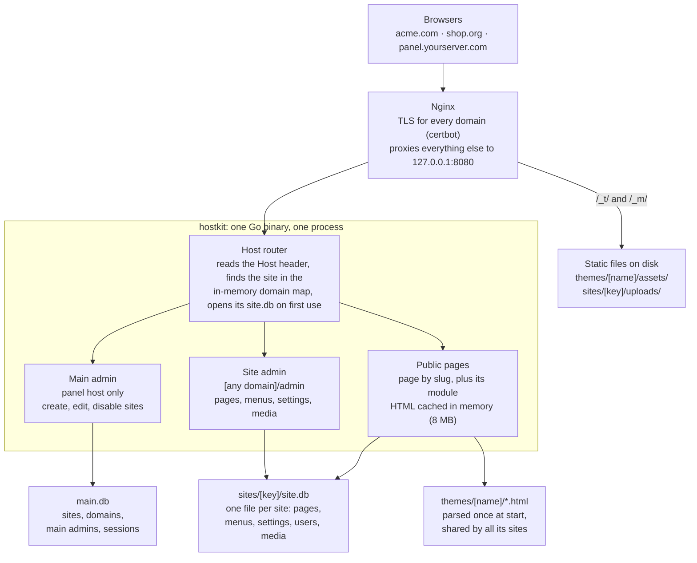

# Multi-Tenant Website Engine (Go + SQLite) — Project Description

## Overview and goals

One Go binary serves every website on the server, choosing the site, its theme, its pages and its admin panel from the request's host name. Each site keeps its own SQLite file; one small main admin panel defines which hosts exist.

The working name used below is **hostkit**. Rename freely.

**Priorities, in order:**

1. **Minimum RAM.** Target: under 50 MB resident for 20 sites, under 30 MB idle.
2. **Minimum CPU.** No per-request template parsing, no ORM, no reflection-heavy frameworks.
3. **Longevity.** Code should build and run unchanged for 8+ years. Use the Go standard library first; allow at most 3 external modules.

**Design rules that follow from the priorities:**

- One process for all sites. Never one process or container per site.
- No JavaScript build step. The admin panels are server-rendered HTML forms with a few lines of vanilla JS at most.
- No custom template language. Go's `html/template` already does layouts, sections and partials (what Blade does), with automatic HTML escaping.
- Every feature must be explainable in one paragraph. If it can't be, it doesn't go in the core.
- SEO is part of the core, not of the theme. Every host gets sitemap, robots.txt, redirects, canonical URLs and full meta tags without theme work.
- The site admin manages routes, SEO, menus, settings and media. The real content often comes from the host's own templates, components and modules; the admin panel does not try to be a page builder.
- No multilingual logic inside a site. A host is a domain plus an optional path prefix, so `domain.com` and `domain.com/de` are two separate sites with two databases, two themes (or the same one) and two admin panels. See "Languages: one site per language".

**Non-goals:**

- Not a page builder (no drag-and-drop editor).
- No plugin marketplace or runtime plugin loading. Custom code is compiled into the binary.
- No multi-server scaling, no MySQL/PostgreSQL support.
- No e-commerce, CRM or user-generated content beyond simple forms.

## Architecture



Nginx handles TLS and static files, then hands every other request to one hostkit process on localhost. The host router loads the domain map from `main.db` at start and after each change in the main admin, then sends the request to the main admin, a site admin or a public page.

## Data storage

There is one `main.db` for the host registry and one `site.db` per website, so a site can be backed up, moved or deleted by copying or removing one folder.

**Filesystem layout** (`/srv/hostkit` by default, set with a flag):

```
/srv/hostkit/
  hostkit              # the binary
  main.db              # hosts, main admins, sessions
  sites/
    acme/              # one folder per site (site key)
      site.db
      uploads/         # media files, served by Nginx
  themes/
    default/           # shared themes, usable by any site
    acme-custom/       # a theme only one site uses
```

**SQLite settings**, applied on every connection: `journal_mode=WAL`, `synchronous=NORMAL`, `foreign_keys=ON`, `busy_timeout=5000`. Site databases open lazily on first request and close after 10 minutes idle, so 50 rarely visited sites cost almost nothing.

**main.db tables:**

| Table | Key columns | Purpose |
| --- | --- | --- |
| `sites` | id, key, name, theme, lang, status (active / disabled), admin_enabled, created_at | One row per website (one per language) |
| `domains` | domain, path_prefix (PK is both; prefix is `''` or like `/de`), site_id, is_primary | Hosts that map to a site; a host is a domain (or a subdomain like `shop.domain.com`) plus an optional path prefix; aliases redirect to the primary; `www.` hosts are never stored |
| `main_admins` | id, email, password_hash | Users of the main admin panel |
| `sessions` | token_hash, user_ref, scope (main / site key), expires_at | Login sessions for both panel types |

**site.db tables:**

| Table | Key columns | Purpose |
| --- | --- | --- |
| `pages` | id, slug, title, body_html, template, module, status (draft / published), sort, updated_at, **SEO:** seo_title, meta_description, canonical, robots, og_title, og_description, og_image, json_ld, alternates, sitemap_priority, sitemap_changefreq, in_sitemap | All pages (routes); `template` picks a theme file, `module` attaches Go code; `body_html` may be empty when the template or module makes the whole content |
| `redirects` | id, from_path, to_url, code (301 / 302), hits | Per-site URL redirects, managed by the site admin |
| `menus` | id, key (e.g. main, footer) | Named menus a theme can ask for |
| `menu_items` | id, menu_id, parent_id, label, url or page_id, sort | Menu entries, one level of nesting |
| `settings` | key, value | Site title, logo, contact email, any key a theme wants; also the SEO keys `seo_title_suffix`, `default_og_image`, `robots_txt`, `head_html`, `body_end_html` |
| `media` | id, file_name, mime, size, alt, created_at | Uploaded files |
| `users` | id, email, password_hash, role (admin / editor) | Site admin users |
| `module_data` | module, key, value_json, created_at | Generic storage for small modules (form submissions, news items) |

Schema changes ship as numbered SQL files embedded in the binary. On start, hostkit applies any missing migrations to `main.db` and to each `site.db` when it opens, tracked by `PRAGMA user_version`.

## Main admin panel

The main admin panel lives on one dedicated host name (for example `panel.yourserver.com`, set in a config flag) and does only one job: create, edit and disable sites.

**Screens:**

1. **Login.** Email and password. The first main admin is created from the command line: `hostkit admin create you@example.com`.
2. **Sites list.** Name, primary domain, theme, status, last updated. One button: Add site.
3. **Add / edit site.** Fields: site name, site key (folder name, lowercase letters, digits and dashes), hosts (one per line, first one is primary; a host is `domain.com` or `domain.com/de`), language code (for `<html lang>` and `og:locale`), theme (dropdown of folders in `themes/`), first site admin email and password. A host that is already used by another site is rejected.
4. **Site actions.** Disable (returns HTTP 503 with a simple maintenance page), enable, open site admin, download backup (a zip of the site folder), delete (requires typing the site key; moves the folder to `sites/.trash/`).

**What happens when a site is created:** hostkit creates `sites/<key>/`, creates `site.db` with all migrations, inserts a Home page and an empty main menu, creates the first site admin user, and reloads the domain map in memory. No restart is needed.

**Main admin also needs:** a Themes list showing each theme folder and a Reload button that re-parses templates after you edit theme files on disk. Nothing else goes in this panel.

## Site admin panel

Every site gets the same admin panel at `https://<its-domain>/admin`. Its HTML templates are embedded in the binary and shared by all sites, so one fix reaches every site. A theme never changes the admin panel's look.

A site can turn its admin panel off entirely (setting `admin_enabled = false`, changeable only from the main admin). Sites with no admin are then edited by the main admin through an "open site admin" link.

**The site admin is not a full CMS.** A host often has its own templates, components and modules (Go code) that make the real content. The admin panel's job is to manage what changes per site: the routes (pages), their titles and SEO data, menus, settings, media, sitemap, robots.txt and redirects. A page can have an empty body when its template or module produces the content.

**Sections are per site.** `theme.json` lists which sections the admin shows (`"admin": ["pages", "menus", "seo", "media"]`). A host that only needs routes and SEO sees only those. The main admin can override the list per site. Pages and SEO are always available.

| Section | What the user can do |
| --- | --- |
| Pages (routes) | List, add, edit, delete, reorder. Edit form has two tabs. **Content:** title, slug (the route), template (dropdown from theme), module (dropdown), body (plain textarea, may be empty), status. **SEO:** SEO title, meta description, canonical URL, robots (index/noindex, follow/nofollow), Open Graph title / description / image, JSON-LD block, sitemap priority and change frequency, include in sitemap. A live preview shows how the Google result and the share card will look. |
| Menus | Pick a menu (main, footer, or any key the theme declares), add items linking to a page or a URL, reorder with up/down buttons, one level of nesting. |
| SEO | Site status: **under construction** on/off plus a message (visitors get HTTP 503 and `noindex`, `robots.txt` disallows all; only people logged in to this site's admin see the site; a theme may provide `under-construction.html`). Site-wide SEO: title suffix, default Open Graph image, Organization JSON-LD fields, `robots.txt` text (editable, default allows all and points to the sitemap), redirects table (from path → to URL, 301 or 302, hit count), custom `<head>` HTML and end-of-body HTML (analytics, verification tags, the host's own scripts), and a link to the live `sitemap.xml`. |
| Settings | A form generated from the theme's `theme.json` settings list (site title, logo, phone, social links). Unknown keys are kept, not lost. |
| Media | Upload, list, delete, copy URL, edit alt text. Images over 2,000 px wide are rejected rather than resized, to keep CPU and code low. |
| Modules | Only appears if the site has modules. Each module adds its own screen (for example, view contact-form submissions). |
| Users | Admins only: add or remove editors, change passwords. |

Editors can manage pages, menus and media; only admins can change SEO site settings, settings and users.

## Languages: one site per language

hostkit has no multilingual features inside a site. Instead, each language of a website is its own site. `domain.com` is one site and `domain.com/de` is another, with its own `site.db`, its own theme (or the same one), its own pages, menus, settings, media and its own admin panel at `domain.com/de/admin`. To the software they are as separate as two different domains. This removes all translation logic from the core; the only thing hostkit needs is to treat a **domain plus a path prefix as a host**.

**How a prefixed host works:**

- A host is `domain` + `path_prefix`. The prefix is empty or one segment like `/de`, `/en`, `/fr`. Nested prefixes (`/de/at`) are allowed but not needed.
- Lookup is longest prefix first. A request for `domain.com/de/kontakt` matches the `/de` host, and the site sees the path `/kontakt`. A request for `domain.com/design` does not match `/de`, because matching is per segment.
- A prefixed host without a root site is fine. `domain.com/` then returns 404, or the owner creates a small root site with a redirect row `/` → `/de`.
- Every URL hostkit builds for a site starts with its prefix: menu links, canonical, Open Graph URL, sitemap entries, admin links, module routes. Templates use `.Site.BasePath` (`""` or `/de`) when they build links by hand.
- The session cookie of a prefixed site is set with `Path=/de/`, so the two admin panels on the same domain never see each other's cookie.
- Static files are unchanged: theme assets stay at `/_t/<theme>/` and uploads at `/_m/<site-key>/`.
- Each site has a `lang` code (set in the main admin). `{{seo}}` prints `og:locale` from it and the layout prints `<html lang="{{.Site.Lang}}">`.

**SEO details that follow from this:**

- `robots.txt` is only read by crawlers at the domain root. So the root site serves `/robots.txt`, and hostkit automatically appends one `Sitemap:` line for every prefixed site on the same domain (`Sitemap: https://domain.com/de/sitemap.xml`). A prefixed site's `/de/robots.txt` still answers, but it is not used by crawlers. If there is no root site, hostkit serves a default `robots.txt` with the sitemap lines of all prefixed sites.
- Each site has its own `/de/sitemap.xml`, which is valid because a sitemap may list only URLs under its own path.
- `hreflang`: a page has an optional "Alternate languages" field, one `lang=URL` per line (for example `de=https://domain.com/de/ueber-uns`). `{{seo}}` prints `<link rel="alternate" hreflang="…">` for each line plus the page's own language. The site admin shows the sister sites on the same domain next to the field, so the editor can copy their URLs. Nothing is matched automatically, because slugs differ per language.

## Theme and template system

Use Go's built-in `html/template`, not a custom Blade clone. It already gives layouts, overridable sections, partials, loops, conditions and automatic HTML escaping, and it will be maintained as long as Go is. hostkit only adds a folder convention and about 12 helper functions.

**Blade to Go, side by side:**

| Blade | Go `html/template` |
| --- | --- |
| `@extends('layout')` | Every page file is parsed together with `layout.html` automatically |
| `@section('content') … @endsection` | `{{define "content"}} … {{end}}` |
| `@yield('content')` | `{{block "content" .}}default{{end}}` |
| `@include('partials.header')` | `{{template "header" .}}` |
| `{{ $title }}` (escaped) | `{{.Page.Title}}` (escaped by default) |
| `{!! $html !!}` (raw) | `{{.Page.Body}}` where Body has type `template.HTML` |
| `@foreach … @endforeach` | `{{range …}} … {{end}}` |
| `@if … @endif` | `{{if …}} … {{end}}` |

**Theme folder:**

```
themes/clean/
  theme.json          # name, menus it uses, settings fields, admin sections
  layout.html         # the HTML skeleton: head, header, footer
  partials/*.html     # header.html, footer.html, ...
  components/*.html   # listbox.html, card.html, pricing-table.html, ... (see Components)
  pages/default.html  # used when a page picks no template
  pages/*.html        # contact.html, landing.html, ... (show up in the page form's dropdown)
  404.html
  assets/             # css, js, images, fonts (served by Nginx)
```

At startup (and on Reload), each page template is parsed once together with `layout.html`, all partials and all components, then kept in memory. Rendering a page is a map lookup plus one `Execute` call; no file reads, no parsing.

**Components.** A component is a small, reusable piece of HTML that belongs to one theme, so it carries that host's own styles and colors. Each file in `components/` defines one named template, for example `components/listbox.html` holds `{{define "c/listbox"}} … {{end}}`. Its CSS lives in the theme's `assets/`. A component is used in three ways:

1. **From a page template or partial**, with arguments: `{{template "c/listbox" (dict "Title" "News" "Items" (pages "news/" 5))}}`. The `dict` helper builds the argument map, because `html/template` passes only one value.
2. **From a page body** written in the admin, as a shortcode: `[[listbox title="News" prefix="news/"]]`. At render time hostkit replaces each shortcode with the component's output, passing the attributes as a map. Unknown component names are left as text.
3. **Nested** inside another component the same way as in 1.

Components are never shared between themes. If two themes need the same listbox, each theme gets its own copy and styles it its own way. A `theme.json` entry `"components": {"listbox": {"title": "text", "prefix": "text"}}` is optional and only used to show the shortcode's fields in the admin page editor's "Insert component" list.

**Data every template receives:**

- `.Site` — Name, Domain, BasePath (`""` or `/de`), Lang, Settings (map)
- `.Page` — Title, Slug, Body, MetaDescription, Template, UpdatedAt
- `.Request` — Path, Query (for simple dynamic pages)
- `.Data` — whatever the page's module returned (see next section)

**Helper functions:**

| Function | Example | Returns |
| --- | --- | --- |
| `menu` | `{{range menu "main"}}` | Menu items with Label, URL, Active, Children |
| `setting` | `{{setting "phone"}}` | One setting value |
| `asset` | `{{asset "css/style.css"}}` | `/_t/clean/css/style.css?v=<hash>` (cache-busting) |
| `media` | `{{media "logo.png"}}` | Public URL of an upload |
| `page` | `{{with page "about"}}{{.Title}}{{end}}` | Another page by slug |
| `pages` | `{{range pages "news/" 5}}` | Up to 5 published pages whose slug starts with `news/`, newest first |
| `date` | `{{date .Page.UpdatedAt "2006-01-02"}}` | Formatted date |
| `excerpt` | `{{excerpt .Body 160}}` | Plain-text summary |
| `t` | `{{t "read_more"}}` | Translation from `theme.json` strings, for multilingual themes |
| `csrf` | `{{csrf}}` | Hidden input for forms posting to a module |
| `dict` | `{{template "c/card" (dict "Title" .Page.Title "Big" true)}}` | Builds a map to pass several values to a component |
| `seo` | `{{seo}}` in `<head>` | The whole SEO head block: title, meta description, canonical, robots, Open Graph, Twitter card, JSON-LD, plus the site's custom head HTML |
| `bodyEnd` | `{{bodyEnd}}` before `</body>` | The site's custom end-of-body HTML (analytics, host scripts) |

**Converting an existing HTML/CSS design into a theme (target: under 30 minutes):**

1. Copy the design's CSS, JS, images and fonts into `assets/`. Replace their paths with `{{asset "…"}}`.
2. Take `index.html`. Everything that repeats on every page (head, header, nav, footer) becomes `layout.html`. Put `{{block "content" .}}{{end}}` where the page body was.
3. Replace the `<title>` text with `{{.Page.Title}} – {{.Site.Name}}`.
4. Replace the hard-coded nav links with a `{{range menu "main"}}` loop over one `<li>`.
5. Create `pages/default.html` containing `{{define "content"}}<h1>{{.Page.Title}}</h1>{{.Page.Body}}{{end}}`.
6. For each special-looking page in the design (landing, contact), make one more file in `pages/`.
7. List the menus and any editable texts (phone, address) in `theme.json`, use them with `setting`, and press Reload.

A `hostkit theme check <folder>` command parses the theme and reports missing blocks, unknown helpers and broken asset paths before you assign it to a site.

## Special and dynamic pages: modules

Anything a template alone can't do is a **module**: plain Go code compiled into the binary and switched on per page. A page with `module = "contact"` runs that module before its template renders, and the module's result lands in `.Data`.

There is no runtime plugin loading. Go plugins are fragile across versions, and recompiling a single binary takes seconds.

**The module interface:**

```go
type Module interface {
    Name() string
    // Handle runs for GET and POST on a page that uses this module.
    // Return data for the template, or write a response yourself (redirect, JSON) and return handled=true.
    Handle(ctx *Ctx) (data any, handled bool, err error)
    // Optional: extra screens in the site admin (nil if none).
    Admin() []AdminScreen
}

// Ctx gives a module everything it needs, scoped to one site.
type Ctx struct {
    Site     *Site        // settings, key
    Page     *Page
    DB       *sql.DB      // this site's site.db only
    W        http.ResponseWriter
    R        *http.Request
    Store    ModuleStore  // helper over the module_data table
}
```

Modules register themselves in `init()` with `module.Register(contact.New())`. The page form's Module dropdown lists all registered modules.

**Modules to build in version 1:**

| Module | Does | Storage |
| --- | --- | --- |
| `contact` | Form with honeypot + rate limit; saves submissions, optionally emails them via SMTP | `module_data` |
| `list` | Lists child pages (for example news, projects) with pagination via `?p=2` | `pages` |
| `search` | Simple full-text search over the site's pages | SQLite FTS5 table |
| `redirect` | Page that 301-redirects to a URL in its settings | none |

**Site-specific modules.** When one site needs something unusual (a booking form, a price calculator), write it as a module in `modules/<name>/` and restrict it to that site key. If a module needs its own tables, it ships its own migration files, which run only on the sites that use it.

**Routing order** for a request on a site: `/admin/*` → static assets (Nginx handles these first) → module routes that claim a URL prefix (for example `/api/booking/`) → page by slug → `404.html`.

## SEO (built into the core, on every host)

Every host gets the same SEO features from the base structure. A theme only has to put `{{seo}}` in `<head>` and `{{bodyEnd}}` before `</body>`. Nothing is optional per theme; a theme that forgets `{{seo}}` fails `hostkit theme check`.

**Per page (edited in the page form's SEO tab):**

- `<title>`: SEO title if set, else page title, plus the site's title suffix.
- Meta description, canonical URL (defaults to the page's own URL on the primary domain), robots meta (`index,follow` by default).
- Open Graph (`og:title`, `og:description`, `og:image`, `og:url`, `og:type`, `og:site_name`) and Twitter card (`summary_large_image`), falling back to the page title, meta description and the site's default image.
- JSON-LD block: free text per page, validated as JSON on save. Common types (Article, Product, FAQ) are written by the host's templates or modules into `.Data` and printed by `{{seo}}`.
- Sitemap fields: include yes/no, priority (0.0 – 1.0), change frequency.
- Alternate languages: one `lang=URL` per line, printed as `hreflang` links (see "Languages: one site per language").

**Per site (SEO section of the site admin):**

- Title suffix (` – Acme`), default Open Graph image, Organization JSON-LD (name, logo, phone, social links) printed on every page.
- `robots.txt` text, served at `/robots.txt`. Default: allow all, `Sitemap: https://<primary>/sitemap.xml`. A disabled site serves `Disallow: /`. Only the root site's file is read by crawlers; hostkit appends the sitemap lines of prefixed sites on the same domain to it.
- `sitemap.xml`, generated from published pages with `in_sitemap = 1`, with `lastmod` from `updated_at`. Modules can add their own URLs (for example every news item) through an optional `Sitemap(ctx) []SitemapURL` method. Cached in the page cache, cleared on any save.
- Redirects table: `from_path` → `to_url`, 301 or 302, with a hit counter. Checked before page lookup. Used when a host changes a slug or moves from an old site.
- Custom `<head>` HTML and end-of-body HTML: the host's own analytics, verification tags and scripts. Stored as-is (admin-entered HTML is trusted).

**Automatic, no setting needed:**

- Alias domains redirect 301 to the primary domain. `www.<host>` always redirects 301 to `<host>` for every host (also `www.sub.domain.com` → `sub.domain.com`); this rule is fixed and a `www.` host can not be defined. A subdomain is a separate host, like another domain. Trailing slash is removed with a 301 (except `/`). Slugs are lower-case; a request with upper-case letters redirects to the lower-case URL.
- Correct status codes: 404 for unknown pages, 503 with `Retry-After` for disabled sites, 410 is available in the redirects table (code 410, empty target) for removed pages.
- `ETag` and `Last-Modified` on cached pages; `Cache-Control` on static assets (Nginx).
- Changing a page's slug offers to add a 301 redirect from the old slug (checkbox, checked by default).
- Media files have an `alt` field; the `media` helper can print the `` tag with it.
- Clean HTML output: `html/template` escapes everything; no inline framework scripts; pages are server-rendered, so crawlers see full content.

## Security, performance and caching

**Security:**

- Passwords hashed with bcrypt (cost 12) from `golang.org/x/crypto`.
- Sessions: random 32-byte token in an `HttpOnly`, `Secure`, `SameSite=Lax` cookie; only its SHA-256 hash is stored. Site-admin sessions are bound to that site's key, so a login on one site never works on another.
- CSRF token on every admin form and every module form.
- Login rate limit: 5 failures per IP per 15 minutes, held in memory.
- Uploads: allow-list of extensions and MIME types (images, PDF, common documents), random file names, never executed. Nginx serves `uploads/` with `X-Content-Type-Options: nosniff`.
- A module only ever receives its own site's database handle. There is no API that reaches another site's data.
- Admin-entered page HTML is trusted (admins are you or your clients). Module form input is always escaped by templates.
- Security headers set by Nginx: HSTS, `X-Frame-Options`, a basic Content-Security-Policy per theme if needed.

**Performance and RAM budget:**

- `GOMEMLIMIT=40MiB` in the systemd unit, so the Go garbage collector works harder before the process grows.
- Set the SQLite page cache to 1 MB per database (`PRAGMA cache_size=-1000`); close idle site databases after 10 minutes.
- Templates are parsed once per theme and shared by every site using that theme.
- Static files (theme assets and uploads) never touch Go; Nginx serves them directly with long cache headers.

**Page cache:** rendered HTML of pages without a module is cached in memory, keyed by site and path, capped at 8 MB total (least recently used are evicted). Any save in that site's admin clears that site's cache. Pages with a module are never cached unless the module says so. Cached responses also get an `ETag`, so repeat visitors receive 304 responses.

## Code structure, dependencies and deployment

**Dependencies (the whole list):**

| Module | Why |
| --- | --- |
| Go standard library | HTTP server, `html/template`, `embed`, `database/sql`, crypto, logging (`log/slog`) |
| `modernc.org/sqlite` | Pure-Go SQLite driver: no C compiler needed, the binary is fully static |
| `golang.org/x/crypto` | bcrypt (and `acme/autocert` if Go terminates TLS itself) |

No web framework, router library or ORM. Go 1.22+ `http.ServeMux` already supports methods and path patterns (`GET /admin/pages/{id}`).

**Source layout:**

```
hostkit/
  cmd/hostkit/main.go     # flags, CLI commands (serve, admin create, theme check)
  internal/
    tenant/               # domain map, site registry, lazy DB open/close
    render/               # theme loading, helper funcs, page cache
    store/                # SQL queries for pages, menus, settings, media, users
    auth/                 # sessions, bcrypt, CSRF, rate limit
    mainadmin/            # main admin handlers + embedded templates
    siteadmin/            # site admin handlers + embedded templates
    module/               # Module interface and registry
  modules/                # contact, list, search, redirect, site-specific ones
  migrations/main/*.sql
  migrations/site/*.sql
```

**Request flow:** read the `Host` header → strip port, lower-case → look up the domain map (in memory) with the first path segment, longest prefix wins → unknown host returns 404, an alias redirects 301 to the primary host, a disabled site returns 503 → strip the site's prefix from the path → open (or reuse) that site's `site.db` → route as described in the modules section.

**Deployment on Debian:**

- Build on any machine with `CGO_ENABLED=0 GOOS=linux go build -trimpath -ldflags="-s -w"`, copy one file to the server.
- Run as a dedicated `hostkit` user under systemd, listening on `127.0.0.1:8080`, with `Restart=on-failure`, `MemoryMax=80M` and `GOMEMLIMIT=40MiB`.
- Nginx: one catch-all `server` block that proxies everything to hostkit, plus two `location` blocks that serve files directly: `/_t/<theme>/…` from `themes/<theme>/assets/` and `/_m/<site>/…` from `sites/<site>/uploads/`. Use a regex location so only `uploads/` is reachable, never `site.db`.
- TLS with certbot: add each new domain's certificate when the site is created (`certbot --nginx -d example.com -d www.example.com`).

**Backups:** a nightly systemd timer runs `hostkit backup`, which uses SQLite's online `VACUUM INTO` to copy every database safely while running, then archives each site folder to `/srv/backups/<date>/<site>.tar.gz`, keeping 14 days. Copy that folder off the server with rsync or rclone.

## Milestones and acceptance criteria

Build in five phases; each ends with something usable on the real server.

1. **Core serving.** Domain map, lazy site DBs, migrations, theme loading, page rendering, 404, one example theme. Sites are created by CLI only.
2. **Main admin.** Login, site list, add/edit/disable/delete site, theme reload, backup download.
3. **Site admin.** Pages (routes) with SEO tab, menus, SEO section (robots.txt, redirects, head/body HTML), settings form from `theme.json`, media, users and roles, per-site section list.
4. **Modules.** Module interface and registry; `contact`, `list`, `search`, `redirect`.
5. **Hardening.** Page cache with ETag, rate limits, `hostkit theme check`, nightly backup timer, systemd and Nginx example files, a README with the HTML-to-theme guide.

**Acceptance criteria for version 1:**

- [ ] 20 sites with 50 pages each: resident memory under 50 MB after 1,000 mixed requests, under 30 MB after 10 idle minutes.
- [ ] A cached page renders in under 1 ms and an uncached one in under 5 ms, measured inside the app on the target server.
- [ ] A new site goes from "Add site" to a live page with no restart and no config file edits (apart from its TLS certificate).
- [ ] A static HTML/CSS template converts into a working theme in under 30 minutes by following the README.
- [ ] `go build` works with `CGO_ENABLED=0` and at most the three dependencies listed above.
- [ ] A session from site A is rejected on site B, and a module on site A can't read site B's data (covered by tests).
- [ ] Restoring a site from its nightly backup archive works by unpacking it into `sites/` and pressing Reload.
- [ ] Every host serves `/robots.txt` and `/sitemap.xml`, and every page prints title, meta description, canonical, robots, Open Graph and JSON-LD from `{{seo}}` (covered by tests).
- [ ] A redirect added in the site admin works on the next request, and an alias domain, `www`, trailing slash and upper-case slug all 301 to one canonical URL.
- [ ] A theme component can be used from a template with `dict` and from a page body as a `[[name …]]` shortcode, and the same component name in two themes renders two different outputs.
- [ ] A theme that lists only `["pages", "seo"]` in `theme.json` shows only those sections in its site admin.
- [ ] `domain.com` and `domain.com/de` run as two separate sites: separate databases, themes, admin panels and sessions; `domain.com/design` is not caught by the `/de` host; the root `robots.txt` lists the `/de/sitemap.xml` (covered by tests).
